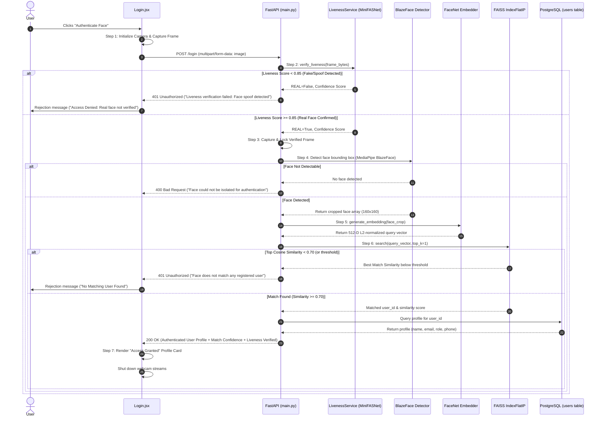

# Biometric 2.0: Complete Architectural Breakdown & Technical Flow

## Executive Summary
**Biometric 2.0** is an enterprise-grade, anti-spoofing facial recognition authentication system. It implements a strict **liveness-first** biometric pipeline: camera frames are rigorously evaluated for physical presentation liveness using **MiniFASNetV1SE** before any downstream facial landmark detection (**MediaPipe BlazeFace**), feature vector extraction (**FaceNet Inception-ResNet-v1**), or vector indexing (**FAISS / PostgreSQL**) occurs.

---

## 1. Where Everything is Stored (Data Storage Architecture)

| Data Category | Specific Item | Physical Storage Location | File / Service Layer | Storage Mechanism & Format |
|---|---|---|---|---|
| **User Identity & Demographics** | User ID, Name, Email, Role, Phone, Timestamps | **PostgreSQL** (`biometricDB`) | `users` table via `database.py` & `user_service.py` | Relational rows (`VARCHAR`, `TIMESTAMP`). Single source of truth. |
| **Biometric Face Embeddings** | 512-dimensional feature vector | **PostgreSQL** (`biometricDB`) | `users.embedding` column | `FLOAT8[]` (double precision array). Persistent vector backup across restarts. |
| **Real-Time Similarity Index** | 512-D vectors with fast indexing | **In-Memory RAM** | FAISS `IndexFlatIP(512)` managed by `faiss_service.py` | Normalized inner product index ($O(1)$ to $O(N)$ cosine similarity search). Loaded on backend startup. |
| **Index-to-User Mapping** | Integer FAISS ID $\leftrightarrow$ `user_id` | **In-Memory RAM** | `faiss_service.py` (`_index_to_user_id`, `_user_id_to_index`) | Thread-safe bidirectional Python dictionaries. |
| **Auditable Face Crops** | Cropped face image | **Local Filesystem** | `backend/cropped_faces/{user_id}_face.jpg` | Saved **only upon successful registration** for visual record keeping. Purged on user deletion. |
| **Anti-Spoofing Neural Weights** | MiniFASNetV1SE PyTorch checkpoint | **Local Filesystem** | `liveliness/weights/MiniFASNetV1SE.pth` | PyTorch serialized state dict (~1.8 MB), loaded once into memory on backend startup. |
| **Face Detector Model Asset** | MediaPipe BlazeFace short-range | **Local Filesystem** | `backend/blaze_face_short_range.tflite` | MediaPipe / TFLite binary model graph (~229 KB). |
| **Environment & Secrets** | DB credentials, API keys, thresholds | **Local Filesystem** | `backend/.env` | Key-value pairs (`DB_USER`, `DB_PASSWORD`, `ADMIN_API_KEY`, `LIVENESS_REAL_THRESHOLD`, `BIOMETRIC_COSINE_THRESHOLD`). |

---

## 2. File-by-File Blueprint

```
biometric2.0/
├── backend/
│   ├── database.py                     # PostgreSQL connection pool & health checks
│   ├── faiss_service.py                # In-memory FAISS IndexFlatIP & ID mapping
│   ├── generate_embedding.py           # FaceNet (160x160) feature extractor & L2 normalization
│   ├── init_db.py                      # Database schema creator and table migrations
│   ├── liveness_service.py             # MiniFASNetV1SE model loader & anti-spoofing detector
│   ├── main.py                         # FastAPI routes, lifecycle hooks & pipeline orchestration
│   ├── user_service.py                 # User business logic, transactions, & DB-FAISS sync
│   ├── blaze_face_short_range.tflite   # MediaPipe BlazeFace model weights
│   ├── requirements.txt                # Backend dependencies (Torch, TF, FAISS, MediaPipe)
│   ├── .env                            # Active environment configuration
│   └── test_*.py                       # Full backend test suites (unit, integration, regression)
├── frontend/
│   ├── src/
│   │   ├── components/
│   │   │   ├── Registration.jsx        # 7-step webcam enrollment with real-time UI stepper
│   │   │   ├── Login.jsx               # 7-step webcam authentication with liveness feedback
│   │   │   ├── UserDirectory.jsx       # User administration & directory viewer
│   │   │   └── DeleteUserModal.jsx     # Admin-protected user deletion dialog
│   │   ├── App.jsx                     # Top-level view switcher and layout
│   │   └── main.jsx                    # React entry point
│   └── package.json                    # Frontend dependencies (React, Vite, Lucide-React)
├── liveliness/
│   ├── weights/
│   │   └── MiniFASNetV1SE.pth          # Pretrained MiniFASNet weights
│   ├── models/                         # PyTorch network architectures
│   └── utils.py                        # MiniFASNet crop & bounding box helpers
└── docs/                               # Engineering documentation & architecture specifications
```

### Backend Modules Detail

1. **`backend/main.py`**:
   - Central entry point and REST router for the FastAPI application.
   - Hosts `POST /upload` (and `POST /register`), `POST /login`, `POST /check-liveness`, `GET /users`, and `DELETE /users/{user_id}`.
   - Synchronously schedules CPU-intensive inferences (`_process_registration_sync` and `_process_login_sync`) in thread pools to maintain non-blocking asynchronous event loops.
   - Lifespan startup hooks load `LivenessService`, `FaceNet`, `MediaPipe`, and initialize `FAISSService` directly from PostgreSQL.

2. **`backend/liveness_service.py`**:
   - Manages the MiniFASNetV1SE anti-spoofing inference engine.
   - Runs face localization via `RetinaFace` (`uniface`), crops with expansion scale 4.0, resizes to $(80 \times 80)$, and applies softmax over 3 classes:
     - Class 0: Replay/Screen Spoof
     - Class 1: **REAL Human Face**
     - Class 2: Printed Paper Spoof
   - Enforces configurable confidence threshold `LIVENESS_REAL_THRESHOLD` (default: `0.85`).
   - Thread-safe via internal mutex lock (`threading.Lock()`).
   - **Fail-Closed Principle**: If weights fail to load or model encounters any fault, inference immediately rejects the frame.

3. **`backend/generate_embedding.py`**:
   - Wraps FaceNet (`Inception-ResNet-v1`) trained on VGGFace2.
   - Contains MediaPipe BlazeFace detection and cropping pipeline.
   - Preprocesses detected face to $(160 \times 160)$ pixels in RGB color space.
   - Runs forward pass to produce 512-D vector and performs strict $L_2$ normalization:
     $$\vec{v}_{\text{norm}} = \frac{\vec{v}}{\|\vec{v}\|_2}$$
   - Ensures mathematical equivalence between Inner Product and Cosine Similarity:
     $$\text{Cosine Similarity}(\vec{a}, \vec{b}) = \vec{a} \cdot \vec{b} \quad \text{when } \|\vec{a}\| = \|\vec{b}\| = 1$$

4. **`backend/faiss_service.py`**:
   - Wraps `faiss.IndexFlatIP(512)` for high-throughput nearest-neighbor vector search.
   - Maintains bidirectional in-memory dictionaries `_index_to_user_id` and `_user_id_to_index`.
   - On server startup, automatically fetches all active user embeddings from PostgreSQL and populates the index.
   - Supports atomic vector insertions, user vector deletions (`remove_user`), and top-$k$ nearest neighbor search.

5. **`backend/user_service.py`**:
   - Implements transactional database operations with automatic rollbacks.
   - `register_user_with_embedding()`: Inserts user profile and 512-D embedding array into PostgreSQL, verifies successful commit, and synchronizes the FAISS index.
   - `delete_user_completely()`: Transactionally deletes the user from PostgreSQL, removes the vector from FAISS, and unlinks the face crop image from disk.

6. **`backend/database.py`**:
   - Configures PostgreSQL connection pooling (`psycopg2.pool.ThreadedConnectionPool`).
   - Manages safe resource allocation with `get_db_connection()` context manager.

---

## 3. End-to-End Registration Flow

```mermaid
sequenceDiagram
    autonumber
    actor User
    participant UI as Registration.jsx
    participant API as FastAPI (main.py)
    participant Live as LivenessService (MiniFASNet)
    participant Crop as BlazeFace Detector
    participant FaceNet as FaceNet Embedder
    participant PG as PostgreSQL (users table)
    participant FAISS as FAISS IndexFlatIP
    participant Disk as Local Filesystem

    User->>UI: Clicks "Register Face"
    UI->>UI: Step 1: Camera Initialization & Capture Frame
    UI->>API: POST /upload (multipart/form-data: fields + image)
    
    API->>Live: Step 2: verify_liveness(frame_bytes)
    alt Liveness Score < 0.85 (Fake/Spoof Detected)
        Live-->>API: REAL=False, Confidence Score
        API-->>UI: 400 Bad Request ("Anti-spoofing check failed: Spoof detected")
        UI->>User: Rejection message ("Please face camera directly; photos/screens prohibited")
    else Liveness Score >= 0.85 (Real Face Confirmed)
        Live-->>API: REAL=True, Confidence Score
        API->>API: Step 3: Capture & Lock Verified Frame
        API->>Crop: Step 4: Detect face bounding box (MediaPipe BlazeFace)
        alt Face Not Detectable
            Crop-->>API: No face bounding box found
            API-->>UI: 400 Bad Request ("No face detected in verified frame")
        else Face Detected
            Crop-->>API: Return cropped face array (160x160)
            API->>FaceNet: Step 5: generate_embedding(face_crop)
            FaceNet-->>API: Return 512-D L2-normalized float vector
            
            API->>PG: Step 6A: INSERT user details + embedding
            PG-->>API: Transaction Committed
            API->>FAISS: Step 6B: add_vector(user_id, embedding)
            FAISS-->>API: Vector Indexed
            API->>Disk: Step 6C: Save cropped face to cropped_faces/{user_id}_face.jpg
            API-->>UI: 200 OK (User ID, Profile, Liveness Verified)
            UI->>UI: Step 7: Display "Registration Successful!"
            UI->>UI: Shut down webcam streams
        end
    end
```

### Strict Security Rules During Registration
1. **Zero Processing on Fake**: If MiniFASNet flags a spoof, **MediaPipe BlazeFace and FaceNet are never invoked**.
2. **Zero Ingestion on Failure**: No database records are created, no vectors added to FAISS, and no images written to disk if liveness fails.
3. **Identical Frame Guarantee**: The exact frame validated by MiniFASNet is passed to BlazeFace and FaceNet—no secondary frame capture is permitted.

---

## 4. End-to-End Login Flow



---

## 5. Security, Anti-Spoofing & Mathematical Guarantees

### A. Anti-Spoofing Architecture (MiniFASNetV1SE)
- **Model Backbone**: MobileNet-style inverted residual blocks with Depthwise Separable Convolutions and Squeeze-and-Excitation (SE) attention modules.
- **Input Geometry**: Faces localized using `RetinaFace`, expanded by a scale factor of $4.0$ to include surrounding environment clues (screen edges, paper boundaries, specular glare), and resized to $(80 \times 80)$.
- **Multi-Class Output Softmax**:
  $$P(\text{class}) = \frac{e^{z_i}}{\sum_{j=0}^2 e^{z_j}}$$
  The system strictly enforces:
  $$\text{Real Confidence} = P(\text{Class } 1) \ge \text{LIVENESS\_REAL\_THRESHOLD } (0.85)$$
- **Observed Spoof Defense**:
  - Genuine Face: $\approx 0.9999$ Real Confidence
  - Printed Paper Photo: $\approx 0.1834$ Real Confidence $\rightarrow$ **REJECTED**
  - Screen / Digital Replay: $\approx 0.0051$ Real Confidence $\rightarrow$ **REJECTED**

### B. Mathematical Cosine Similarity in FAISS
- FaceNet generates raw feature vectors $\vec{x} \in \mathbb{R}^{512}$.
- $L_2$ Normalization:
  $$\vec{u} = \frac{\vec{x}}{\|\vec{x}\|_2} = \frac{\vec{x}}{\sqrt{\sum_{i=1}^{512} x_i^2}}$$
- When vectors are unit-length, the Inner Product computed by FAISS `IndexFlatIP` is identically the Cosine Similarity:
  $$\langle \vec{u}_{\text{query}}, \vec{u}_{\text{enrolled}} \rangle = \cos(\theta)$$
- Matching Acceptance Rule:
  $$\cos(\theta) \ge \text{BIOMETRIC\_COSINE\_THRESHOLD } (0.70)$$

### C. Thread Safety & Fail-Closed Guardrails
- **Mutex Locks**:
  - `LivenessService`: `threading.Lock()` guards PyTorch forward passes.
  - `EmbeddingService`: `_embedder_lock` guards TensorFlow / FaceNet forward passes.
  - `FAISSService`: `_lock` guards vector queries and updates.
- **Fail-Closed Policy**: If the liveness model weights are missing or corrupt, `LivenessService` enters an error state and rejects **100% of requests**. The system never silently bypasses anti-spoofing.

---

## 6. HTTP API Specifications

### 1. `POST /upload` or `POST /register`
- **Content-Type**: `multipart/form-data`
- **Fields**: `name`, `email`, `role`, `phone`, `user_id` (optional), `image` (file)
- **Flow**: MiniFASNet $\rightarrow$ BlazeFace $\rightarrow$ FaceNet $\rightarrow$ PostgreSQL $\rightarrow$ FAISS $\rightarrow$ Disk
- **Responses**:
  - `200 OK`: `{"status": "success", "user_id": "...", "liveness": {"verified": true, "real_score": 0.9999}}`
  - `400 Bad Request`: Spoof detected, no face detected, or email already registered.

### 2. `POST /login`
- **Content-Type**: `multipart/form-data`
- **Fields**: `image` (file), `claimed_user_id` (optional for 1:1 verification)
- **Flow**: MiniFASNet $\rightarrow$ BlazeFace $\rightarrow$ FaceNet $\rightarrow$ FAISS Search $\rightarrow$ PostgreSQL Fetch
- **Responses**:
  - `200 OK`: `{"status": "success", "match": true, "similarity": 0.884, "user": {...}}`
  - `401 Unauthorized`: Spoof detected, or similarity below threshold.

### 3. `POST /check-liveness` or `POST /api/liveness`
- **Content-Type**: `multipart/form-data`
- **Fields**: `image` (file)
- **Responses**:
  - `200 OK`: `{"is_real": true, "real_score": 0.9999, "threshold": 0.85}`

### 4. `GET /users`
- Returns array of all registered user profiles and enrollment timestamps.

### 5. `DELETE /users/{user_id}`
- Header: `X-API-Key: <ADMIN_API_KEY>`
- Transactionally purges PostgreSQL row, drops vector from FAISS, and removes disk crop.

---

## 7. Verification & Testing Playbook

To verify the entire system end-to-end, run the following test commands:

```bash
# 1. Run the comprehensive Liveness-First Pipeline suite (10 tests)
backend\facenet_env\Scripts\python.exe backend/test_liveness_pipeline.py

# 2. Run 1:N Biometric Identification & Registration suite (5 tests)
backend\facenet_env\Scripts\python.exe backend/test_1n_login_and_registration.py

# 3. Run Milestone 6 Authentication Verification suite (5 tests)
backend\facenet_env\Scripts\python.exe backend/test_milestone6_login.py

# 4. Run Complete User Deletion & Purge suite (6 tests)
backend\facenet_env\Scripts\python.exe backend/test_delete_user.py

# 5. Run In-Memory FAISS Vector Index suite (6 tests)
backend\facenet_env\Scripts\python.exe backend/test_faiss_service.py

# 6. Verify Frontend Production Build
npm.cmd --prefix frontend run build
```

---
*Document Version: 2.0 (Liveness-First Architecture)*  
*Engineered for Google Antigravity Biometric Authentication*
